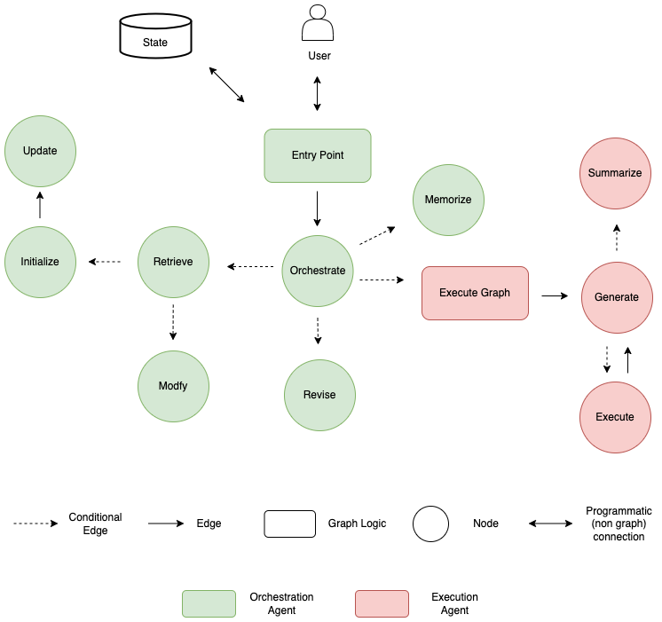
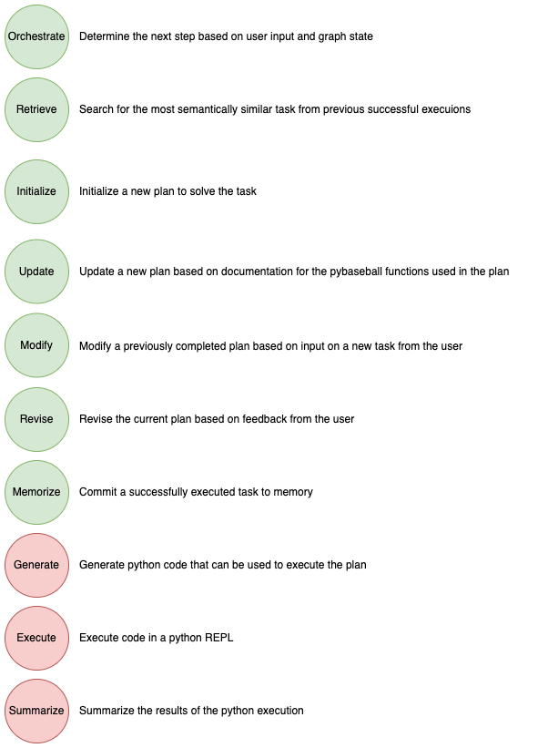

# Multi-Agent Data Analysis Assistant with LangGraph

## Overview

The purpose of this repository is to demonstrate how LangGraph can be used to build a stateless multi-agent workflow to serve as an assistant for data analysis.  This workflow leverages the [pybaseball](https://github.com/jldbc/pybaseball) Python library to extract data which is then used for analysis based on the user's request.

The workflow consists of two agent systems: one for general workflow and planning and another for code generation and execution.  An Agent is fundamentally a language model on a loop until some stopping condition is met, and a Graph is what we use to define the loop. For this reason, "Agent" and "Graph" are used interchangeably in this documentation.



The graphs are organized in a modular manner so that each node serves a specific purpose.



## Sample Usage

The sample notebooks demonstrate three simple use cases as examples of how this system can be used.  

```
1.  How many home runs did Derek Jeter hit in 2010?
```

```
2.  Plot the cumulative sum of strikeouts thrown by Danny Duffy in the 2018 season.
```

```
3.  Consider the first week of August 2020 - find 3 pitchers who's curveballs were most similar to Max Scherzer's.
```

## Getting Started
1. Clone repository and navigate to the `langgraph-multi-agent` folder 
2. Update local `env` file with the required environment variables and rename to `.env`

## Running the Jupyter Notebooks
1. Create and activate a virtual environment
```
python3 -m venv venv
```
```
source venv/bin/activate
```
2. Install requirements
```
pip install -r requirements.txt
```
3. Open and execute the sample Jupyter Notebooks in order.  You must ensure that the Jupyter notebook is running a python kernel tied to the virtual environment you have created so that the required libraries will be available.  

The intent of the sample notebooks is to first demonstrate a use case that is unknown to the agent system, and then to demonstrate a slight variation of the same use case after the system has learned the pattern.

## Folder Structure

```
langgraph-multi-agent
│   README.md
│   .gitignore    
│   requirements.txt   
│   env  :  Template for creating local .env file  
│   *_sample_*.ipynb  :  Demonstration of a use case
│
└───images
│   │   workflow.drawio.png  
│   │   nodes.drawio.png 
│
└───graphs
│   │   __init__.py
│   │   execute_graph.py : Resposible for generating and executing Python code to execute the plan
│   │   orchestrate_graph.py : Resposible for general orchestration and plan creation
│
└───state
│   │   __init__.py
│   │   create_functions_statsapi.ipynb : Helper notebook to persist pybaseball function metadata
│   │   data_dictionary.py : String representations of the data dictionary for pybaseball functions
│   │   functions.json : Output from create_functions_statsapi.ipynb that will be read by the agent system
│
└───function
│   │   __init__.py
│   │   baseball_lambda.py : Entrypoint for the Agent system
│
└───nodes
│   └───execute
│   │   │   __init__.py
│   │   │   execute_node.py : Responsible for creating the Execute Node
│   │   │   generate_node.py : Responsible for creating the Generate Node
│   │   │   summarize_node.py : Responsible for creating the Summarize Node
│   │
│   └───orchestrate
│   │   │   execute_graph_node.py : Triggers the Execute Graph
│   │   │   initialize_node.py : Responsible for creating the Initialize Node
│   │   │   memorize_node.py : Responsible for creating the Memorize Node
│   │   │   modify_node.py : Responsible for creating the Modify Node
│   │   │   orchestrate_node.py : Responsible for creating the Orchestrate Node
│   │   │   retrieve_node.py : Responsible for creating the Retrieve Node
│   │   │   revise_node.py : Responsible for creating the Revise Node
│   │   │   update_node.py : Responsible for creating the Update Node
│
└───vectordb
│   │   __init__.py
│   │   create_execution_plan_vectordb_entries.ipynb : Helper notebook to create or clear execution plans
│   │   execution_plan.csv : Execution plans are written to disk so that they can be read by vector database
│   │   vectordb.py : Helper function for creating and retrieving the vector database collection for execution plans

```
---

## 🎯 Project Objectives

The main objective of this project is to explore how multiple AI agents can work together to solve complex tasks through structured workflows and intelligent coordination.

- Build modular AI agents with specialized responsibilities.
- Coordinate agent execution using graph-based workflows.
- Improve task handling through structured decision-making.
- Create a flexible foundation for developing advanced Agentic AI applications.

## 🧠 Understanding Multi-Agent AI

A multi-agent system consists of multiple AI agents that can perform different tasks and collaborate to achieve a common goal.

Unlike a traditional single-agent application, a multi-agent architecture can divide complex tasks into smaller, manageable steps.

With LangGraph, developers can represent these workflows using nodes, edges, shared state, and conditional transitions.

## 🏗️ Workflow Architecture

A typical multi-agent workflow can follow this process:

1. **User Input:** Receive the user's question or task.
2. **Task Analysis:** Understand the objective and determine the next action.
3. **Agent Execution:** Route the task to the appropriate specialized agent.
4. **Information Processing:** Process the task and exchange relevant information.
5. **Response Generation:** Combine the results and prepare the final response.

> Note: The actual workflow depends on the agents and graph structure implemented in this repository.

## ⚙️ Core Concepts

- **LLM Integration:** Use a language model to understand requests and generate responses.
- **Graph-Based Orchestration:** Define the sequence of operations using nodes and edges.
- **State Management:** Maintain relevant information throughout workflow execution.
- **Conditional Routing:** Select the next step based on the current state or decision.
- **Modular Design:** Organize agent responsibilities into reusable components.

## 💡 Why Multi-Agent Systems?

Multi-agent systems are useful when a problem requires multiple specialized capabilities.

- **Separation of Responsibilities:** Each agent can focus on a specific task.
- **Modularity:** Individual components can be developed and improved independently.
- **Flexible Workflows:** Tasks can follow different execution paths.
- **Extensibility:** New agents and tools can be added as the project evolves.
- **Maintainability:** A modular architecture can simplify debugging and development.

## 🚀 Potential Applications

The multi-agent approach can be adapted for applications such as:

- AI-powered research assistants
- Automated data analysis
- Intelligent document processing
- Software development assistants
- Customer support automation
- Knowledge retrieval and question answering
- Research and report generation

These are potential use cases, not claims that every capability is already implemented in this project.

## 🔐 Configuration and Security

- Store API keys and other secrets in environment variables.
- Keep `.env` files and credentials out of public repositories.
- Use a `.env.example` file to document required configuration variables.
- Avoid committing sensitive information, access tokens, or private datasets.

## 🛠️ Future Improvements

Possible directions for extending this project include:

- Adding more specialized AI agents.
- Integrating external tools and APIs.
- Implementing persistent conversation memory.
- Adding workflow tracing and execution logs.
- Introducing structured output validation.
- Adding error handling and retry mechanisms.
- Evaluating agent responses for accuracy and reliability.
- Developing a user-friendly interface for interacting with the system.

## 📚 Learning Resources

- [LangGraph Documentation](https://docs.langchain.com/oss/python/langgraph/overview)
- [LangGraph Multi-Agent Workflows](https://www.langchain.com/blog/langgraph-multi-agent-workflows)
- [LangChain Documentation](https://docs.langchain.com/)

## 👨‍💻 Author

**Ravi Kumar Rao**

B.Tech Information Technology | AI/ML | Data Science | Agentic AI

- GitHub: [@Ravi506051](https://github.com/Ravi506051)

---

If you find this project useful, consider giving the repository a ⭐ on GitHub.

## Experiment and Safety Notes

Use the sample notebooks to understand the graph flow before changing agent prompts or tools. Record the data source, query, execution environment, and generated outputs for each experiment so results can be reproduced. Review generated code before running it, especially when adapting the workflow to data outside the supplied examples.

## Extension Ideas

Potential improvements include explicit input validation, clearer error states for failed tool calls, structured output validation, and tests for graph routing and stopping conditions. Document which parts are deterministic and which depend on an LLM.

## Project Development Notes

Document text normalization, vectorization, model choice, and label balance. Evaluate with precision, recall, F1, and error examples on held-out reviews.

For reproducibility, record source versions, environment and dependency versions, configuration, and actual test outputs. Clearly label sample data and illustrative results; never commit secrets or private data.

### Technical Deep Dive

The graph-based workflow separates planning from code generation/execution and uses shared state to pass intermediate results between nodes. Keep state fields explicit, define conditional routing and termination criteria, and bound retries so a failed code-generation step cannot loop indefinitely. For data-analysis agents, compute factual aggregates with deterministic Python rather than asking the LLM to invent row counts or statistics.

Suggested engineering checks: validate generated code against an allowlisted execution environment, set time and memory limits, avoid passing secrets into child processes, and document that subprocess isolation alone does not block filesystem or network access.
